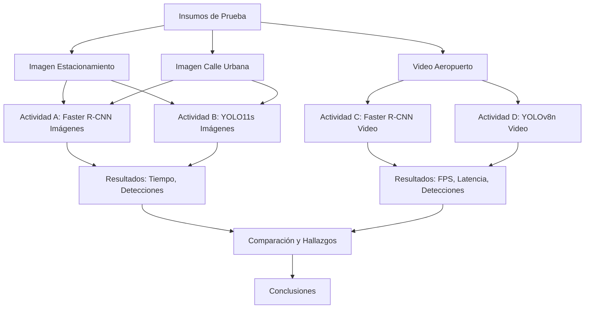

# 🎯 Comparativa de Detección de Objetos: R-CNN vs YOLO

<p align="center">
  
  
  
  
  
</p>

<p align="center">
  <b>Comparación de arquitecturas de dos etapas (Faster R-CNN) y una etapa (YOLO) para la detección de objetos en imágenes y video.</b>
</p>

---

## 📋 Descripción General

Este repositorio contiene el desarrollo y la comparación de **cuatro aplicaciones** de detección de objetos, utilizando dos paradigmas arquitectónicos distintos:

*   **R-CNN (Faster R-CNN):** Enfoque de dos etapas (propuestas de región + clasificación).
*   **YOLO (You Only Look Once):** Enfoque de una sola etapa (regresión directa).

El objetivo es evaluar el comportamiento de ambos modelos en términos de **velocidad (latencia, FPS)** y **precisión cualitativa**, tanto en imágenes estáticas como en flujos de video (simulando tiempo real).

---

## 📂 Estructura del Repositorio

```
comparativa-deteccion-objetos-rcnn-yolo/
│
├── assets/                          # Insumos de prueba (imágenes y video)
│   ├── imagen_estacionamiento.png
│   ├── imagen_calle_urbana.png
│   └── video_aeropuerto.mp4
│
├── 01_faster_rcnn_imagenes.ipynb    # Actividad A: Detección con Faster R-CNN en imágenes
├── 02_yolo_imagenes.ipynb           # Actividad B: Detección con YOLO11s en imágenes
├── 03_faster_rcnn_video.py          # Actividad C: Detección con Faster R-CNN en video (Interfaz gráfica)
├── 04_yolo_video.py                 # Actividad D: Detección con YOLOv8n en video
│
├── requirements.txt                 # Dependencias del proyecto
└── README.md                        # Este archivo
```

---

## 🔄 Flujo de Trabajo



---

## 🛠️ Tecnologías Utilizadas

| Herramienta | Versión | Uso |
| :--- | :--- | :--- |
| Python | 3.10+ | Lenguaje principal |
| PyTorch / Torchvision | 2.0+ | Modelos Faster R-CNN |
| Ultralytics | 8.x | Modelos YOLOv8 / YOLO11 |
| OpenCV | 4.x | Procesamiento de imágenes y video |
| NumPy / Pandas | - | Análisis de datos |
| Matplotlib | - | Gráficos |
| Gradio | - | Interfaz web para YOLO en imágenes |
| CustomTkinter | - | Interfaz de escritorio para R-CNN en video |

---

## 📊 Resultados Principales

### Imágenes (Actividades A y B)

| Insumo | Modelo | Detecciones | Tiempo (ms) |
| :--- | :--- | :--- | :--- |
| Imagen Estacionamiento | Faster R-CNN | 9 | 1000.75 |
| Imagen Estacionamiento | YOLO11s | 7 | 136.3 |
| Imagen Calle Urbana | Faster R-CNN | 24 | 1009.63 |
| Imagen Calle Urbana | YOLO11s | 30 | 129.4 |

### Video (Actividades C y D)

| Métrica | Faster R-CNN (MobileNetV3) | YOLOv8n |
| :--- | :--- | :--- |
| Latencia promedio (ms) | 1265.59 | 61.59 |
| FPS | 0.79 | 16.24 |
| Total de detecciones | 8818 | 7392 |

> **Conclusión clave:** YOLO es **~20 veces más rápido** que Faster R-CNN en CPU, lo que lo hace viable para tiempo real. Faster R-CNN es más preciso en escenas complejas, pero su latencia lo hace inviable para video en vivo sin GPU.

---

## 🚀 Cómo Ejecutar

### 1. Clonar el repositorio
```bash
git clone https://github.com/tu-usuario/comparativa-deteccion-objetos-rcnn-yolo.git
cd comparativa-deteccion-objetos-rcnn-yolo
```

### 2. Instalar dependencias
```bash
pip install -r requirements.txt
```

### 3. Ejecutar las aplicaciones

*   **Actividad A (Faster R-CNN en imágenes):** Abre `01_faster_rcnn_imagenes.ipynb` en Jupyter o Google Colab.
*   **Actividad B (YOLO en imágenes):** Abre `02_yolo_imagenes.ipynb` en Google Colab (recomendado).
*   **Actividad C (Faster R-CNN en video):** Ejecuta `python 03_faster_rcnn_video.py`. Se abrirá una interfaz gráfica para seleccionar el video.
*   **Actividad D (YOLO en video):** Ejecuta `python 04_yolo_video.py`. Asegúrate de que el video esté en la carpeta `assets/` o en la ruta especificada en el script.

---

## 📝 Notas y Limitaciones

*   **Hardware:** Todas las pruebas se realizaron en **CPU**. Los tiempos de inferencia se reducirían drásticamente en GPU.
*   **Métricas:** No se calculó mAP (Mean Average Precision) debido a la falta de etiquetas de referencia (Ground Truth) en las imágenes.
*   **Video:** El video utilizado es de Pixabay (dominio público) y se encuentra en la carpeta `assets/`.

---

```
